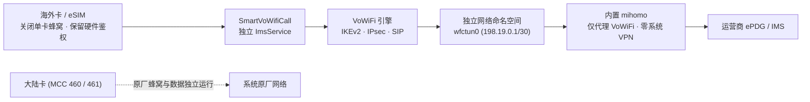

<div align="center">

<br>


<h1>SmartVoWifiCall</h1>

<h3>海外卡网络通话，本该如此。</h3>

<p>大陆卡稳在网，海外卡独立走代理，不占系统 VPN。</p>

<br>

<p>
  <a href="https://github.com/YubaiNya/SmartVoWifiCall/releases"></a>
  
  <a href="https://github.com/YubaiNya/SmartVoWifiCall/issues"></a>
  <br>
  <a href="https://github.com/YubaiNya/SmartVoWifiCall/blob/main/LICENSE"></a>
  <a href="https://ifdian.net/a/YubaiNya"></a>
  <a href="https://linux.do/u/YubaiNya"></a>
  <a href="https://linux.sb/u/YubaiNya"></a>
  <a href="https://forum.naixi.net/home.php?mod=space&username=yubai"></a>
  <br>
  <a href="https://github.com/lilyzhaun/softvowifi-client"></a>
  <a href="https://github.com/MetaCubeX/mihomo"></a>
  <a href="https://github.com/compose-miuix-ui/miuix"></a>
  <a href="https://github.com/Kyant0/AndroidLiquidGlass"></a>
</p>

<br>

</div>

---

## 为什么做它

在双卡手机上使用海外卡 Wi-Fi Calling，传统方案往往要全局挂 VPN、担心误触海外漫游，或者一换 eSIM 就掉线卡死。SmartVoWifiCall 通过独立的 Android `ImsService`，把整条通话链路彻底收拢在后台静默运转。

<table>
  <tr>
    <td width="50%" valign="top">
      <strong>双卡各走各路</strong><br><br>
      大陆卡保留系统原厂蜂窝与 IMS；海外卡独立接管语音与短信，并通过单卡协议栈开关关闭海外卡蜂窝，普通通话绝不误回退漫游。
    </td>
    <td width="50%" valign="top">
      <strong>零 VPN 占位，只代理通话</strong><br><br>
      内置 <code>mihomo</code> 运行在独立 Linux 网络命名空间，只接管 VoWiFi 隧道流量，不改系统路由表，不代理手机里的其他任何应用，无 Wi-Fi 时也可借大陆卡数据直连。
    </td>
  </tr>
  <tr>
    <td width="50%" valign="top">
      <strong>多 eSIM 切卡，节点自动跟随</strong><br><br>
      按 SIM 身份记住每张海外卡对应的代理节点。香港卡、英国卡互相切换时，自动清理旧绑定、切换地区节点并立即重连，告别跨区拒连与漫长退避。
    </td>
    <td width="50%" valign="top">
      <strong>安静省电，随开随停</strong><br><br>
      开启通话服务自动拉起代理，关闭后待通话结束自动停内核、复原蜂窝。待机零常驻通知，仅通话录音期间持有必要的无声前台服务，挂断即释放。
    </td>
  </tr>
</table>

<br>

## 工作原理



- **按需接管与自动回退**：只有独立引擎真实完成运营商 SIP `REGISTER` 后才启用语音覆盖；遇到接口失效或超时自动释放蜂窝并恢复原厂 IMS，手动切节点或点击刷新可立刻重试。
- **液态玻璃管理界面**：内置「概览 / 代理 / 连接 / 网络」四页面，支持订阅拉取、YAML 导入、节点延迟测速、实时连接查看与 External Controller 外部调试。

<br>

## 三步上手

**适用设备**：已 Root（KernelSU / SukiSU / Magisk）的 arm64 Android 13–17 设备，重点在 Xiaomi 15 / Android 17 上持续验证。

1. **刷入模块并重启**
   前往 Releases 下载 `SmartVoWifiCall-module.zip`，在 KernelSU / Magisk 中刷入后重启。模块会自动安装或覆盖升级随包 APK，保留原有设置。
2. **导入代理并选节点**
   打开 SmartVoWifiCall 并授予 Root 权限，在「代理」页填入订阅链接或导入 YAML，选择对应海外卡归属地区的节点。
3. **开启海外卡网络通话**
   回到「概览」页，确认出口为 `wfctun0` 后打开总开关；显示「已注册」后，按需开启「允许通话和发送短信」。

> [!TIP]
> 同一 eSIM 卡槽装有多张不同地区的海外卡时，每张卡只需选一次对应地区节点并注册成功，后续切卡就会自动切换对应节点。

> [!CAUTION]
> 开启「允许通话和发送短信」后将直接通过系统电话和短信发起真实运营商业务，资费按套餐标准收取。本项目仅用于个人合法自用与技术研究。

<br>

## 开发与文档

仓库仅保存源码、测试、模块脚本、文档与交付物校验哈希，不包含签名私钥、个人订阅配置及第三方预编译二进制（来源与 SHA-256 见 `service/deps/`）。

| 目录 | 用途 |
| --- | --- |
| `service/app/` | 独立 `ImsService`、策略与回退引擎、Root 辅助与 Compose 界面 |
| `service/module/` | 模块安装脚本、引擎控制与 Clash 命名空间隔离脚本 |
| `service/tests/` | 策略、单卡互斥、Clash 净化、通话/音频与生命周期回归测试 |
| `service/tools/` | 一键构建、源码打包与交付物完整性校验脚本 |
| `telemetry-worker/` | 可选 Cloudflare Worker 脱敏遥测中转服务（写入私有 GitHub 仓库） |
| `VERSION_HISTORY.md` | 完整版本迭代与真机实测记录 |
| `service/dist/SHA256.json` | 交付物哈希校验清单 |

<details>
<summary><strong>构建命令与技术验证文档</strong></summary>

<br>

```bash
# 策略、回退、单卡互斥与 Clash 配置净化测试
python service/tests/policy/run_tests.py

# 引擎契约、通话/音频与 Feature 生命周期测试
python service/tests/engine/run_tests.py
python service/tests/engine/run_call_tests.py
python service/tests/engine/run_feature_tests.py

# 构建 Release APK / 模块 ZIP 并校验签名与哈希
python service/tools/build.py
python service/tools/verify_artifacts.py
```

- [版本迭代记录（VERSION_HISTORY.md）](./VERSION_HISTORY.md)
- [服务架构与构建详解（service/README.md）](./service/README.md)
- [内置 Clash 隔离命名空间、节能与实机验证](./service/docs/BUILTIN_CLASH_VALIDATION.md)
- [通话终结与麦克风上行修复验证](./service/docs/CALL_FIX_VALIDATION.md)
- [单卡蜂窝互斥（enableModemForSlot）验证](./service/docs/EXCLUSIVE_RADIO_VALIDATION.md)
- [TUN 出口策略验证](./service/docs/TUN_POLICY_VALIDATION.md) · [Provider 路由验证](./service/docs/IMS_FALLBACK_VALIDATION.md)
- [单 ZIP 自动安装 APK 验证](./service/docs/AUTO_APK_VALIDATION.md) · [引擎日志池隔离补丁](./service/docs/ENGINE_ISOLATED_LOG_POOL.md)

</details>

<br>

---

<div align="center">

<p>如果 SmartVoWifiCall 帮到了你，欢迎赞助支持持续更新。</p>

<p>
  <a href="https://ifdian.net/a/YubaiNya">
    
  </a>
</p>

<p>基于 GPL-3.0 开源 · 特别致谢 SoftVoWiFi、mihomo、Miuix 与 AndroidLiquidGlass</p>

</div>
