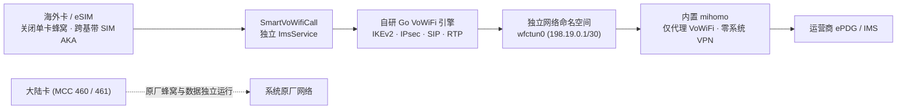

<div align="center">

<br>


<h1>SmartVoWifiCall</h1>

<h3>海外卡网络通话，本该如此。</h3>

<p>大陆卡稳在网，海外卡独立走代理，不占系统 VPN。</p>

<br>

<p>
  <a href="https://github.com/YubaiNya/SmartVoWifiCall/releases"></a>
  
  
  <a href="https://github.com/YubaiNya/SmartVoWifiCall/issues"></a>
  <br>
  <a href="https://github.com/YubaiNya/SmartVoWifiCall/blob/main/LICENSE"></a>
  <a href="https://ifdian.net/a/YubaiNya"></a>
  <a href="https://linux.do/u/YubaiNya"></a>
  <a href="https://linux.sb/u/YubaiNya"></a>
  <a href="https://forum.naixi.net/home.php?mod=space&username=yubai"></a>
  <br>
  <a href="https://github.com/lilyzhaun/softvowifi-client"></a>
  <a href="https://github.com/MetaCubeX/mihomo"></a>
  <a href="https://github.com/compose-miuix-ui/miuix"></a>
  <a href="https://github.com/Kyant0/AndroidLiquidGlass"></a>
</p>

<br>

</div>

---

## 为什么做它

在双卡手机上使用海外卡 Wi-Fi Calling，传统方案往往要全局挂 VPN、担心误触海外漫游，或者一换 eSIM 就掉线卡死。SmartVoWifiCall 通过独立的 Android `ImsService`，把整条通话链路彻底收拢在后台静默运转。

<table>
  <tr>
    <td width="50%" valign="top">
      <strong>双卡各走各路</strong><br><br>
      大陆卡保留系统原厂蜂窝与 IMS；海外卡独立接管语音与短信，并通过单卡协议栈开关关闭海外卡蜂窝，普通通话绝不误回退漫游。
    </td>
    <td width="50%" valign="top">
      <strong>零 VPN 占位，自动绕开系统代理</strong><br><br>
      内置 <code>mihomo</code> 运行在独立 Linux 网络命名空间，自动识别物理网卡（<code>wlan0</code> / <code>rmnet_data*</code>）并绕开系统 <code>tun0</code> VPN，不套娃、不改系统路由表，不代理手机里的其他任何应用。
    </td>
  </tr>
  <tr>
    <td width="50%" valign="top">
      <strong>纯自研 Go 引擎，跨基带通用</strong><br><br>
      底层 VoWiFi 协议栈（IKEv2 / IPsec ESP / IMS SIP / RTP）100% 源码自研零外部依赖，常驻内存低至 1.2 MB；高通走 QRTR、天玑 / Tensor / Exynos 走通用 Binder AKA，彻底摆脱外部预编译二进制依赖。
    </td>
    <td width="50%" valign="top">
      <strong>安静省电，多 eSIM 自动跟节点</strong><br><br>
      常驻 Root 守护进程毫秒级响应，按 SIM 自动记住并切换地区节点；内置 25 家海外运营商规则，断链即下状态栏 VoWiFi 图标，挂断即释录音前台服务。
    </td>
  </tr>
</table>

<br>

## 工作原理



- **按需接管与自动回退**：只有独立引擎真实完成运营商 SIP `REGISTER` 后才启用语音覆盖；遇到接口失效或超时自动释放蜂窝并恢复原厂 IMS，手动切节点或点击刷新可立刻重试。
- **液态玻璃管理界面**：内置「概览 / 代理 / 连接 / 网络」四页面，支持订阅拉取、YAML 导入、节点延迟测速、实时连接查看与 External Controller 外部调试。

<br>

## 三步上手

**适用设备**：已 Root（KernelSU / SukiSU / Magisk）的 arm64 Android 14–17（API 34–37）设备，支持高通骁龙与天玑 / Tensor / Exynos 跨基带 SIM AKA（内置「系统接口兼容性自检」），重点在 Xiaomi 15 / Android 17 上实网验证。

1. **刷入模块并重启**
   前往 Releases 下载 `SmartVoWifiCall-module.zip`，在 KernelSU / Magisk 中刷入后重启。模块会自动安装或覆盖升级随包 APK，保留原有设置。
2. **导入代理并选节点**
   打开 SmartVoWifiCall 并授予 Root 权限，在「代理」页填入订阅链接或导入 YAML，选择对应海外卡归属地区的节点。
3. **开启海外卡网络通话**
   回到「概览」页，确认出口为 `wfctun0` 后打开总开关；显示「已注册」后，按需开启「允许通话和发送短信」。

> [!TIP]
> 同一 eSIM 卡槽装有多张不同地区的海外卡时，每张卡只需选一次对应地区节点并注册成功，后续切卡就会自动切换对应节点。

> [!CAUTION]
> 开启「允许通话和发送短信」后将直接通过系统电话和短信发起真实运营商业务，资费按套餐标准收取。本项目仅用于个人合法自用与技术研究。

<br>

## 日志与遥测

SmartVoWifiCall 内置可选的脱敏日志上报与本地导出能力，全部位于 App 的 **「网络 → 日志与遥测」** 卡片中。

- **默认关闭，完全自愿**：遥测开关默认处于关闭状态，未经你手动开启或点击「立即上传一次脱敏日志」，App 不会向任何服务器发送日志。
- **默认走 Wi-Fi Calling 链路，支持切系统路由**：上传默认复用内置 `mihomo` 的 Wi-Fi Calling 隔离代理链路（`wfctun0`），无需手机主网络挂系统代理即可直达中转接口；未开启内置代理时也可一键切换为「系统路由」。
- **双重脱敏，隐私统一显示为 `[Hidden]`**：上传前在 App 端与 Cloudflare Worker 服务端执行双重脱敏，保留完整诊断结构、原始日志、网络请求与引擎 RPC 包体结构，仅将敏感值统一替换为 `[Hidden]`；同时支持上传前点击「预览脱敏内容」检查实际报文。
- **日志 ID 快速排查**：每次上传都会生成唯一可读日志 ID（如 `SVW-20261124-19B351`）并保存在 App 的「日志上传记录」中，支持一键复制 ID 附在 Issue 里，方便开发者快速定位问题。
- **本地完整导出**：下方随时可通过系统文件选择器手动导出「脱敏日志包（ZIP）」或「原始全部日志包（ZIP）」（原始日志仅存本地，绝不上传）。

<details>
<summary><strong>查看脱敏上传字段与隐藏范围</strong></summary>

<br>

| 类别 | 会上传的非隐私信息 | 统一替换为 `[Hidden]` 的隐私字段 |
| --- | --- | --- |
| **设备与系统** | 机型 / 市场名 / 认证型号、SoC 处理器、运行内存、分辨率 / DPI、厂商系统版本（HyperOS / MIUI / ColorOS / OneUI 等）、Android 版本与安全补丁、基带版本、内核版本、硬件版本 | 设备序列号（`serial`）、`Android ID` |
| **SIM 与通话状态** | 卡槽号、SIM 所属国家（`countryIso`）、运营商名称（`carrierName` / `simOperatorName`）、PLMN、是否 eSIM、IMS / 隧道 / 回退状态 | `ICCID`、`IMSI`、`IMEI`、`simKey`、手机号 / 通话双方号码、SIP 账号用户名、AKA 鉴权密钥 |
| **代理与网络日志** | 接口列表、Clash 节点数量与运行状态、Clash HTTP 与引擎 RPC 完整包体结构、脱敏后的原始引擎 / IMS / `logcat` 日志 | 代理节点名称、订阅链接、控制器密钥、`Authorization` / Token、真实局域网与公网 IP |

</details>

<br>

## 更新日志

> 完整更新记录同步维护于 [UpLog.md](./UpLog.md)（详细技术验证见 [VERSION_HISTORY.md](./VERSION_HISTORY.md)）。

### `v0.5.0-dev`（2026-11-24）— 纯自研 Go 引擎与实网通话里程碑

- **纯自研零依赖 Go VoWiFi 协议栈**：彻底移除 SoftVoWiFi 预编译二进制，纯 Go 静态编译 `vowifi-engine-arm64`（约 4.2 MB，待机 ~1.2 MB RSS），完整实现 IKEv2 + EAP-AKA/AKA'、纯用户态 IPsec ESP、IMS SIP/SMS 与 RTP/DTMF。
- **内置 `mihomo` 自动绕开系统 `tun0` VPN**：通过 `fwmark 0x20000` 动态探测并绑定真实物理网卡（`wlan0` / `rmnet_data*`），消除双层套娃，3HK 实网冷启动注册降至 **1.78 秒**。
- **常驻 `RootDaemonMain` + 跨基带 SIM AKA + Android 14–17**：独立 `/data/local/tmp/smartvowificall/root-daemon.sock`（0–4 ms 响应）；高通走 root netns QRTR、天玑 / Tensor / Exynos 走通用 Binder/APDU；放开 API 34–37 并新增兼容性自检与无 Root 只读模式。
- **通道稳定性与通话体验全面修复**：RFC 7296 合规 DPD + 15s `0xFF` NAT-T 保活；断链即刻清空能力并下掉状态栏 VoWiFi 图标；RTP `JitterBuffer` 支持 `SSRC`/`Marker`/大跳变即时重同步防中途无声；`INVITE` Timer A 重传 + `183`/`180` 早期媒体 + 挂断秒刷 `VoiceServiceOverride` 修复连续拨号；新增硬件 AEC/NS/AGC、快捷磁贴、紧急恢复工具与 25 家海外运营商 / 5 家 OEM 适配库。

<details>
<summary><strong>查看历史版本更新（v0.4.7-dev → v0.1.0-dev，同步自 UpLog.md）</strong></summary>

<br>

- **`v0.4.7-dev`（2026-11-24）**：遥测上传默认走 Wi-Fi Calling 隔离代理链路（支持一键切系统路由），升级 `[Hidden]` 双重脱敏、非隐私设备/SIM 排障信息与唯一日志 ID（`SVW-YYYYMMDD-XXXXXX`）。
- **`v0.4.6-dev`（2026-11-23）**：新增可选脱敏遥测上传（默认关闭）+ Cloudflare Worker 中转服务，新增本地手动导出「脱敏日志 ZIP」与「原始全部日志 ZIP」。
- **`v0.4.5-dev`（2026-11-23）**：按 SIM 记忆与自动切换代理节点，切节点/刷新立即破除退避，完善 eSIM 切卡租约迁移与恢复。
- **`v0.4.4-dev`（2026-11-23）**：修复远端挂断后下一通卡死 DIALING 与 Android 17 录音静音（silenced），仅通话期间持有无声 `microphone` 前台服务。
- **`v0.4.3-dev`（2026-11-23）**：开启网络通话联动启停内置代理，稳定态降频轮询与深度节能，精简中文状态文案。
- **`v0.4.2-dev`（2026-11-23）**：修复挂断后 Telecom 清除语音覆盖导致的再次呼出失败，强引用持有 `ImsConfigImplBase`。
- **`v0.4.0-dev`（2026-11-22）**：全新 Apple Design + Miuix + 液态玻璃四页面 UI，内置 Clash External Controller 与实时连接管理，新增 `FallbackPolicy` 自动回退并移除待机常驻通知。
- **`v0.3.2-dev`（2026-11-22）**：新增 `setVoiceServiceStateOverride` 解决关闭海外卡蜂窝后的拨号拦截，修复小米升级后 `ImsService` 不重连。
- **`v0.3.1-dev`（2026-11-22）**：内置 Clash 升级为独立 Linux Network Namespace 隔离（零 Android VPN、零根命名空间路由改动）。
- **`v0.3.0-dev`（2026-11-22）**：内置官方 `mihomo` 内核与独立 `wfctun0` 接口，新增订阅拉取、YAML 导入与节点测速切换。
- **`v0.2.5-dev`（2026-11-22）**：引入单卡蜂窝协议栈互斥（`enableModemForSlot`），仅关海外卡蜂窝防误漫游，大陆卡保持在网。
- **`v0.1.0-dev` – `v0.2.4-dev`（2026-11-22）**：建立独立 Android `ImsService` 框架、内置 SIM 凭据与网络快照、单 ZIP 自动覆盖安装 APK、真实 `IFF_TUN` 校验与按需注册接管。

完整说明请直接查看 **[UpLog.md](./UpLog.md)**。

</details>

<br>

## 开发与文档

仓库包含完整的 Android 上层应用、**纯自研零外部依赖 Go VoWiFi 协议栈引擎（`engine/`）**、测试、模块脚本、文档与交付物校验哈希；已彻底移除外部预编译 SoftVoWiFi 二进制依赖，不包含签名私钥或个人订阅配置（内置 `mihomo` 来源与 SHA-256 见 `service/deps/`）。

| 目录 | 用途 |
| --- | --- |
| `engine/` | 纯自研 Go VoWiFi 协议栈（`CGO_ENABLED=0` 静态编译 `arm64`：IKEv2/EAP-AKA/AKA'、用户态 IPsec ESP、IMS SIP/SMS、RTP/DTMF、通用 Binder + 高通 QRTR 跨基带 SIM AKA） |
| `service/app/` | 独立 `ImsService`、策略与回退引擎、跨基带 `RootSimAuthMain`、Root 辅助与 Compose 界面 |
| `service/module/` | 模块安装脚本、引擎控制与 Clash 命名空间隔离脚本 |
| `service/tests/` | 策略、单卡互斥、Clash 净化、通话/音频与生命周期回归测试 |
| `service/tools/` | 一键构建（含自动交叉编译 Go 引擎）、源码打包与交付物完整性校验脚本 |
| `telemetry-worker/` | 可选 Cloudflare Worker 脱敏遥测中转服务（写入私有 GitHub 仓库） |
| `UpLog.md` | 各版本更新日志（已嵌入首页展示） |
| `VERSION_HISTORY.md` | 完整版本迭代与真机实测记录 |
| `service/dist/SHA256.json` | 交付物哈希校验清单 |

<details>
<summary><strong>构建命令与技术验证文档</strong></summary>

<br>

```bash
# 自研 Go VoWiFi 协议栈离线单元测试与端到端回环验证
cd engine && go test -count=1 ./...

# 策略、回退、单卡互斥与 Clash 配置净化测试
python service/tests/policy/run_tests.py

# 引擎契约、通话/音频与 Feature 生命周期测试
python service/tests/engine/run_tests.py
python service/tests/engine/run_call_tests.py
python service/tests/engine/run_feature_tests.py

# 一键编译 Release APK + 静态 arm64 Go 引擎 + 模块 ZIP 并校验签名与完整性
python service/tools/build.py
python service/tools/verify_artifacts.py
```

- [版本迭代记录（VERSION_HISTORY.md）](./VERSION_HISTORY.md)
- [服务架构与构建详解（service/README.md）](./service/README.md)
- [内置 Clash 隔离命名空间、节能与实机验证](./service/docs/BUILTIN_CLASH_VALIDATION.md)
- [通话终结与麦克风上行修复验证](./service/docs/CALL_FIX_VALIDATION.md)
- [单卡蜂窝互斥（enableModemForSlot）验证](./service/docs/EXCLUSIVE_RADIO_VALIDATION.md)
- [TUN 出口策略验证](./service/docs/TUN_POLICY_VALIDATION.md) · [Provider 路由验证](./service/docs/IMS_FALLBACK_VALIDATION.md)
- [单 ZIP 自动安装 APK 验证](./service/docs/AUTO_APK_VALIDATION.md) · [引擎日志池隔离补丁](./service/docs/ENGINE_ISOLATED_LOG_POOL.md)

</details>

<br>

---

<div align="center">

<p>如果 SmartVoWifiCall 帮到了你，欢迎赞助支持持续更新。</p>

<p>
  <a href="https://ifdian.net/a/YubaiNya">
    
  </a>
</p>

<p>基于 GPL-3.0 开源 · 特别致谢 SoftVoWiFi、mihomo、Miuix 与 AndroidLiquidGlass</p>

</div>
